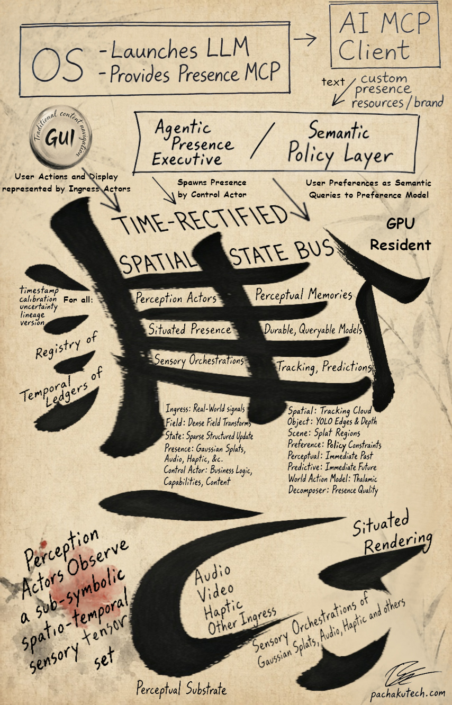

# Pachakutech Presence

A local agent is given one body on the compositor the person is already
using, and six typed actions for marking that screen and speaking
through the body. The package is the MCP binding, the `presence` CLI,
and a Linux x86_64 daemon that owns Vulkan and Wayland. The account of
what that daemon actually does is
[`docs/situated-presence.md`](docs/situated-presence.md). Read it before
the notes under `docs/plans/`.



## What is running

- A layer-shell disc, 220 pixels on a side, idle and with a presence.
  It takes no pointer input and reserves no layout space. A
  heat field over the captured screen chooses the seat. A visible mark
  is written into that field as hot.
- A MakeHuman proxy, 181 joints, about 50,000 Gaussians, skinned and
  reconstructed on the GPU and checked against a CPU oracle at startup.
  The rig is not cut down to the 64-bone palette used for ordinary
  splat clouds.
- Screen and webcam enter as dma-bufs when the device allows it. Body
  colour is sampled from those images. `PRESENCE_APPEARANCE_BAKE=1`
  draws the joint palette instead, and is read only at process start.
- The discs occlude one another. Depth is tested and written. The
  fragment outputs a covered sample at full alpha.
- Speech is Piper and Rhubarb, on this machine. The jaw follows the
  audio. This export of the mesh has no `viseme_*` shape keys, and the
  log says so. The jaw still moves.
- While she is speaking, a visible mark selects a frame of the `Point`
  clip by screen angle. Frames 1–180 are her left hand, which is the
  hand for a mark on the viewer's right. Frame 270 is her right hand.
  The camera is one half-turn about X, so the face comes forward and
  left stays on the viewer's right. She yaws up to a quarter turn
  toward the mark. With no mark, the arms go out to frame 20 and back,
  and the body yaws about two degrees.

Shader history is [`docs/gpu-splat-pipeline.md`](docs/gpu-splat-pipeline.md).
The process split is [`docs/architecture.md`](docs/architecture.md).
The reason the contract looks like this is [`docs/vision.md`](docs/vision.md).

## The blackboard

Each actor posts a frame-coherent message on its own channel when its
work finishes. Inside a message, every value comes from that one pass.
Where the message is a table, the columns are a structure of arrays and
they share one length. A newer message replaces the previous one whole.
A reader takes the latest complete message. The tick carries on while a
writer is still working.

The split is the G-buffer idea, applied to compute state. A G-buffer
keeps albedo, normal, and depth for one frame. Here a channel keeps the
columns of one pass: the words on the glass, the heat cells, or the
pose. The channels keep their own clocks. On this panel the screen-text
pass takes about two and a half seconds, the capture clock is 100 ms,
and the pose tick is 33 ms.

The CPU writes the buffer the next reader samples. For the body, that
reader is the expand pass. One dispatch binds this tick's skin matrices
and morph weights, with the mesh channels beside them, and writes one
finished splat per sample. Locate reads the screen-text channel.
Placement reads the heat. The voice posts when the line is ready, and
the tick polls that message.

That is the blackboard, and the writers are asynchronous. The snapshot
a reader binds is the latest coherent message on the channel it asked
for.

## The control surface

The pose is one channel of that blackboard. It is the record: breath,
gesture, jaw, yaw, and the seat. Each tick the CPU sends that pose as
181 skin matrices and the morph weights. The device rebuilds the 50,000 samples on the deformed mesh
and stores finished splats for the projection shader to draw. The
buffers, the push constant, and the 96-byte record are in
[`docs/control-surface.md`](docs/control-surface.md).

## Speaking and marking

The daemon copies its environment once, at start. The shell that runs
`presence daemon start` has to export `PRESENCE_PIPER_MODEL`,
`PRESENCE_RHUBARB_BIN`, `WAYLAND_DISPLAY`, and `XDG_RUNTIME_DIR`. Rhubarb's
`res/` directory sits beside the rhubarb binary. A variable exported
after start does not reach the process, and `speak` still returns
success.

```bash
presence daemon start
id=$(presence spawn)                 # stdout is only the id
presence highlight "$id" 0.53 0.46 0.12 0.12 45
presence speak "$id" "The sentence inside the mark."
presence retire "$id"
```

A phrase the user can already see is one command. It finds, checks the
crop, tints, then speaks. If the phrase is missing it does neither.

```bash
presence highlight-and-speak "$id" --source web --query "fellow-mortal" \
  --text "The sentence inside the mark."
presence highlight-query "$id" --source pdf --uri ./notes.pdf --page 2 \
  --query "the clause in question"
```

`highlight-and-speak` defaults the tint to 90 seconds. Pass `--seconds`
to override. The ceiling is 360. A reply that walks through more than
one passage is annotated once. `text` is the spoken reply. `--cues` is
a JSON list of `{at, query}` beside it. `at` names one sentence of that
reply. `query` is the passage to find on the page, a phrase or
`start ... end`. The runtime splits the reply, binds each cue to a
sentence, and finds the first passage before any audio. Later passages
move with the sentence clips. On the web the open tab jumps to the
phrase. Views already read, and the cues in them, are written under
`~/.local/share/pachakutech/pages/` for a person to read. A cue in that
file is opened at its scroll, and a search turns around at the end of
the page. A PDF keeps the page number in that file and opens it when the
call does not name a page. A document window is written into the file
from the view on screen. The document reader does not send keys. The tint
comes down for that jump and the new box goes up when the crop passes. A miss leaves the tint down. The voice continues, and
the tint stays up until the voice ends. The safety cap is about as long
as the words. During the quiet between clips the next passage is found. The binding rules are in
[Annotating the reply](docs/situated-presence.md#annotating-the-reply).
`highlight-query` is the same find and tint with no speech. Stdout is one JSON object: the locate box,
`highlight.status`, and, when it speaks, `speak.status`. `--source` is
`web`, `pdf`, `terminal`, `doc`, or `ide`. Web can scroll. PDF takes a
path and `--page`. Terminal, doc, and ide read a window already up and
do not type into it. `ide` is the editor window (`code`, `code-oss`,
`cursor`, `zed`, `jetbrains`); reveal the line first.

Locate reads the daemon's latest screen-text message before it
screenshots a window. The message is the columns of one capture
(`text`, `x`, `y`, `w`, `h`, `conf`), kept for about eight seconds
after it is posted. One hit in the chosen window is the measure, and
the method is `screen-text-memory`. The crop is still read before a
tint. A quiet message, two hits, or a failed crop uses the screenshot
path. `presence screen-text` prints the message. It does not tint and
it does not speak.

`u`, `v`, `w`, and `h` are fractions of the whole composited output,
origin at the top left, `v` downward. A bare `highlight` lasts 5 seconds
unless a duration is passed. The daemon clamps a duration to between 1
and 360. The arms move only while audio is playing and the tint is
still up. After the tint fades, the presence keeps the rectangle and
the stored rectangle does not hold the pose. `speak` returns when the
line is accepted. A second `speak` replaces the line still playing. A
daemon restart drops every live id. `highlight-and-speak` and
`highlight-query` are the fused path. `locate` still returns the box
alone.

The same proposals exist as MCP tools: `spawnPresence`,
`animatePresence`, `manifestHighlight`, `retirePresence`, `addArtifact`,
`retireArtifact`, `locateScreenRegion` (find a phrase, return UV, do not
mark), `highlightAndSpeak` (find, tint, speak, one rate-limit tick), and
`manifestHighlightFromQuery` (find and tint, no speech). A locate failure
inside either fused tool does not tint and does not speak. Full schemas
are in [`src/index.ts`](src/index.ts).
Expected motion, the corner rule, and the camera are written out in
[`docs/situated-presence.md`](docs/situated-presence.md). A one-page
printing of the contract is
[`docs/contract-onepager.html`](docs/contract-onepager.html).

| Tool | Pattern | Does |
|---|---|---|
| `manifestHighlight` | ephemeral | Tints a full-screen UV box. The tint fades. The box remains until replace or retire |
| `locateScreenRegion` | read | Finds a phrase and returns UV JSON. A single hit in the screen-text memory can supply the words. It does not mark or speak |
| `highlightAndSpeak` | fused | Speaks `text`. One passage passes `query`. Several passages pass `cues`, each naming a sentence of `text` and the words to find on the page. The first passage is tinted before any audio. Later ones move with the sentence clips and hold the tint for the utterance. One gate tick. A miss on the first passage does not tint or speak |
| `manifestHighlightFromQuery` | fused | Finds the phrase and tints it. No speech |
| `spawnPresence` | instanced | Returns a `presenceId`. The first live presence receives the body |
| `animatePresence` | instanced | Speaks `text` through that presence |
| `retirePresence` | instanced | Ends it and frees the slot |
| `addArtifact` | instanced | Holds a local `.splat` or `.ply`. The file is read by the daemon. The cloud is not the avatar |
| `retireArtifact` | instanced | Drops a held cloud |

The MCP process applies a policy gate before the socket: 1.5 seconds
between calls to the same tool, at most three presences, at most twenty
artifacts. Retire is not rate-limited. A presence started from the CLI
does not pass through that gate. The CLI and the MCP server write the
same socket.

## Install — Linux x86_64

```bash
npm install -g @pachakutech/presence-mcp
presence doctor
presence daemon start
presence setup claude
```

The package contains the Node binding, the CLI, a prebuilt
`presence-daemon`, and `skills/presence/SKILL.md`. Install does not
compile anything and does not start the daemon. `presence setup claude`
runs `claude mcp add presence -- presence mcp` and copies the skill to
`~/.claude/skills/presence`. `setup codex` and `setup grok` do the same
for those clients. The agent then launches `presence mcp` on stdio. That
process talks to `$XDG_RUNTIME_DIR/pachakutech/presence.sock`.

The daemon runs in a logged-in desktop session, as that user, never as
root. Stop it with `presence daemon stop`. `presence daemon path` prints
the binary that `start` will launch. Its stdout and stderr go to
`$XDG_RUNTIME_DIR/pachakutech/presence-daemon.log`.

The host session is not in the package:

- Linux x86_64.
- A Wayland session (`WAYLAND_DISPLAY`). Hyprland is the compositor this
  was built against.
- A Vulkan loader and a vendor driver.
- The DRM render node (`/dev/dri/renderD128`). logind grants this to the
  seat. Membership of the `render` group is the fallback.
- `/dev/video*` when the webcam is wanted. On most distributions that is
  the `video` group. A missing webcam permission fails quietly.

On a machine with no Vulkan driver the daemon prints the error and exits.
On a working desktop it names the GPU, reports whether dma-buf import is
available, runs a one-splat smoke dispatch, and only then listens. A
failed smoke dispatch is fatal.

If the daemon is down, the binding falls back to `notify-send` and
appends to `~/.local/state/pachakutech-presence/log.jsonl`.

There is no auto-update.

```bash
npm outdated -g --depth=0
npm update -g @pachakutech/presence-mcp
presence daemon restart
presence --version
presence daemon status
```

On Omarchy, [`docs/omarchy.md`](docs/omarchy.md) records an
`omarchy-mise-install` line that has not been verified. The npm install
above is the one that matches this tree.

## Building from this repository

Rust and Cargo are required only for a daemon built here. Shader compile
needs `glslangValidator` (`glslang` on Arch). Run time needs
`vulkan-icd-loader` and a vendor driver.

```bash
git clone https://github.com/Pachakutech/pachakutech-situated-ai-presence-mcp.git
cd pachakutech-situated-ai-presence-mcp
npm install
npm run prepare:package   # tsc, cargo build --release, stage into native/linux-x64
npm link
```

`presence daemon start` runs `native/linux-x64/presence-daemon`. A binary
left in `daemon/target` is not that file. `scripts/stage-daemon.mjs`
copies the release build into place. The contributor recipe, including
the speech variables, is [`docs/dev/debug_build.txt`](docs/dev/debug_build.txt).
The overlay and the ingress path are summarized in
[`daemon/README.md`](daemon/README.md).

`prepare:package` assembles the tarball. `npm publish` runs it from
`prepublishOnly`. `npm install` does not.

## Where the process sits

The MCP server is a child of the agent CLI, on stdio, on this machine.
It inherits the desktop session, including `WAYLAND_DISPLAY`,
`XDG_RUNTIME_DIR`, and `DBUS_SESSION_BUS_ADDRESS`. A systemd unit would
have to be given that environment on purpose. This process does not.

The binding knows the schema. The daemon knows the device. They exchange
one JSON object per line and no buffers. That boundary is described in
[`docs/architecture.md`](docs/architecture.md).

MIT licensed.
[github.com/Pachakutech/pachakutech-situated-ai-presence-mcp](https://github.com/Pachakutech/pachakutech-situated-ai-presence-mcp).
